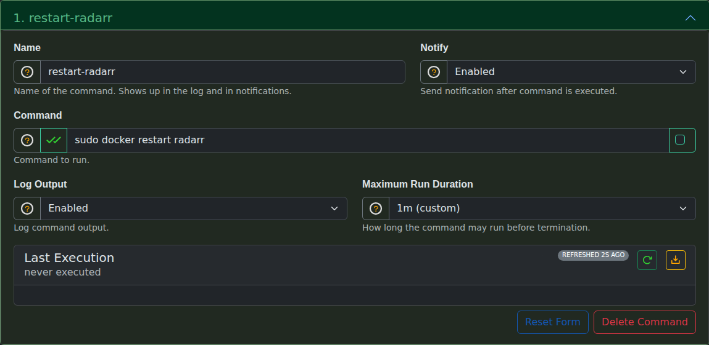

# Notifiarr Client Commands

Commands allow the Notifiarr client to execute custom scripts or shell commands. Commands can be triggered from the client web UI, the Notifiarr website, or from a connected chat server (Discord, Slack, or Telegram).

!!! warning
    Modified commands must be saved before they can be run from the web UI.

---

## Configuration

Each command instance has the following settings:

| Setting | Environment Variable | Description |
| --------- | --------------------- | ------------- |
| **Name** | `DN_COMMAND_{n}_NAME` | Command name, shown in logs and notifications. If omitted, the first command token is used |
| **Notify** | `DN_COMMAND_{n}_NOTIFY` | Send a notification after command execution, including command output |
| **Command** | `DN_COMMAND_{n}_COMMAND` | The command or script to run (required) |
| **Shell** | `DN_COMMAND_{n}_SHELL` | Wrap the command in a shell (`/bin/sh` on non-Windows systems, `cmd /C` on Windows) |
| **Log Output** | `DN_COMMAND_{n}_LOG` | Write command output to the application log |
| **Timeout** | `DN_COMMAND_{n}_TIMEOUT` | Maximum run duration before the command is terminated (default: 15s) |

### Command Arguments

Commands support custom positional arguments using regex syntax `({regex})`. When a command contains argument patterns, users are prompted to provide values that match the specified regex before execution.

### Regex Tester

Use the built-in regular expression tester to verify argument patterns.

### Adding Commands

Click the **+** button to add a new command instance. Multiple commands can be configured.

---

## Command Output

Each command shows execution statistics:

- **Last execution**: When the command was last run
- **Execution count**: Total number of times the command has been executed
- **Failure count**: Number of failed executions (non-zero process exit)
- **Last command**: The exact command string that was executed
- **Output**: The stdout/stderr output from the last execution (click the orange button to expand; this opens automatically when the last run failed)

!!! note "Windows PowerShell"
    Failures increment only when the process exits non-zero. Windows PowerShell cmdlet errors such as `Start-Process` failing are non-terminating, so `powershell.exe -File script.ps1` exits 0 unless the script sets `$ErrorActionPreference = 'Stop'`. The client rewrites direct `powershell.exe`/`pwsh` `-File` invocations (Shell disabled) to run with `$ErrorActionPreference='Stop'` so those errors count as failures. Leave **Shell** off when the command already starts with `powershell.exe`. The console window is hidden; use **Log Output** and the output panel instead of a flashing PowerShell window.

---

## Fill In a Command

You can fill in a command in the Web UI or paste a `[[command]]` block into `notifiarr.conf`. Both set the same values. Each example below gives the block to paste. Open **Commands**, click **Create Command**, and copy the value for each field, or add the block to your config file and restart the client.

| TOML key | Web UI field | Value |
| --- | --- | --- |
| `name` | Name | Text shown in logs and notifications |
| `command` | Command | The command line to run |
| `shell` | Run as shell command checkbox (hover text) | `true` or `false` |
| `notify` | Notify | `true` is Yes, `false` is No |
| `log` | Log Output | `true` is Yes, `false` is No |
| `timeout` | Maximum Run Duration | A duration such as `20s` or `2m`. The Web UI fills in `10s` for a new command. An empty or zero value falls back to `15s` |



The client also writes a `hash` key, a 64-character ID, when it saves the config. Leave it out of a new block and the client generates one. The number of arguments and their regular expressions are not config keys; the client reads them from the `({regex})` patterns in `command`.

---

## Example: Locate an NVIDIA Shield Remote

Add this command if you lose the Shield remote. Run it from your phone through the website or a chat server and the remote beeps, so you do not have to dig through the couch. It takes no arguments. It needs `adb` installed where the client runs (or in a container the client can reach), and that host must reach the Shield on port 5555 with ADB debugging enabled.

```toml
[[command]]
  name    = 'shield-remote-locator'
  command = '''adb -s 192.168.1.50:5555 shell input keyevent KEYCODE_WAKEUP && adb -s 192.168.1.50:5555 shell am start -n com.nvidia.remotelocator/.ShieldRemoteLocatorActivity'''
  shell   = true
  log     = true
  notify  = false
  timeout = "20s"
```

1. Replace `192.168.1.50` with the IP address of your Shield.
2. `shell = true` lets `&&` run the second `adb` call only if the wake key event succeeds. Without a shell, the client runs a single program and passes `&&` to it as an argument.
3. The first call wakes the Shield. The second opens the remote locator screen, which makes the remote buzz.
4. Save the configuration. A changed command must be saved before you can run it.

---

## Example: Ops Commands on Linux

Add these commands to run routine host maintenance without opening an SSH session: restart a container, test a proxy config, or check whether a reboot is due. Run them from the Web UI, the Notifiarr website, or a chat server. None take arguments. They assume the client runs on Linux as the user `notifiarr`; change the user to match your install.

Privileged steps use `sudo`. The client runs a command without a shell by splitting it into a program and arguments, so `sudo docker restart radarr` works with `shell = false`. The client has no password prompt, so each `sudo` call needs a `NOPASSWD` rule in a file under `/etc/sudoers.d/` (edit it with `visudo -f /etc/sudoers.d/notifiarr`). List the full command with its exact arguments. Sudo then allows only that argument list, not other uses of the same program.

### Restart a Container

Use this when an app hangs and a restart fixes it. The notification confirms the restart ran.

```toml
[[command]]
  name    = 'restart-radarr'
  command = '''sudo docker restart radarr'''
  shell   = false
  log     = true
  notify  = true
  timeout = "60s"
```

```text
notifiarr ALL=(root) NOPASSWD: /usr/bin/docker restart radarr
```

Replace `radarr` with the container name in both places. Use `which docker` to confirm the path in the sudoers line. Add one command and one sudoers line per container.

### Validate an Nginx Config

Use this after you edit a proxy config, to confirm it parses before the proxy reloads it.

```toml
[[command]]
  name    = 'nginx-test'
  command = '''sudo docker exec swag nginx -t'''
  shell   = false
  log     = true
  notify  = true
  timeout = "20s"
```

```text
notifiarr ALL=(root) NOPASSWD: /usr/bin/docker exec swag nginx -t
```

Replace `swag` with the name of your nginx or reverse proxy container. `nginx -t` prints its result on stderr. The client captures stdout and stderr together, so the output panel and the notification show the full result. A failed test exits non-zero and counts as a failure.

### Check Reboot Readiness

Use this to find out whether a host needs a reboot after updates, and which services still run outdated libraries, without logging in.

```toml
[[command]]
  name    = 'reboot-check'
  command = '''test -f /var/run/reboot-required && echo "reboot required" || echo "no reboot required"; sudo needrestart -b -r l; systemctl --failed --no-legend'''
  shell   = true
  log     = true
  notify  = true
  timeout = "60s"
```

```text
notifiarr ALL=(root) NOPASSWD: /usr/sbin/needrestart -b -r l
```

1. `shell = true` lets the client run `;`, `&&`, and `||` between the checks. On Linux the client wraps the command in `/bin/sh -c`.
2. `/var/run/reboot-required` exists on Debian and Ubuntu after a package update needs a reboot.
3. `needrestart -b -r l` lists services that use outdated libraries in machine-readable form (`-b`) and does not restart anything (`-r l`).
4. `systemctl --failed --no-legend` lists failed units and needs no `sudo`. It exits 0 even when units have failed, so read the output rather than relying on the failure count.

---

## Instructions

1. Navigate to the Commands page in the Notifiarr client web UI
2. Add a new command with a name and the command string to execute
3. Optionally enable notifications and logging
4. Save the configuration
5. Run the command from the web UI, the Notifiarr website, or a chat server
